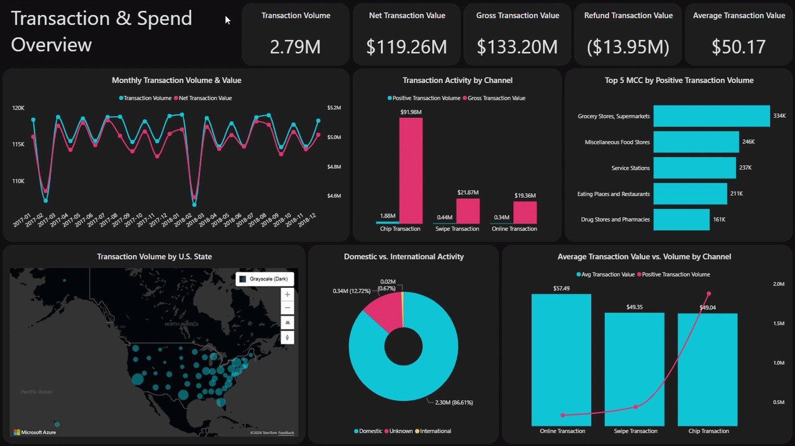
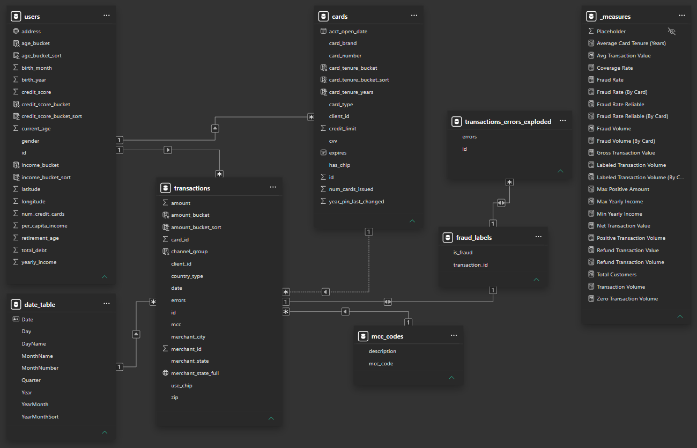
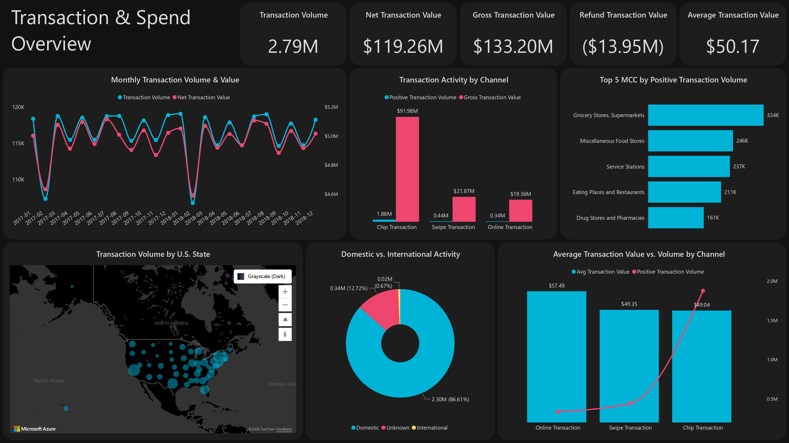
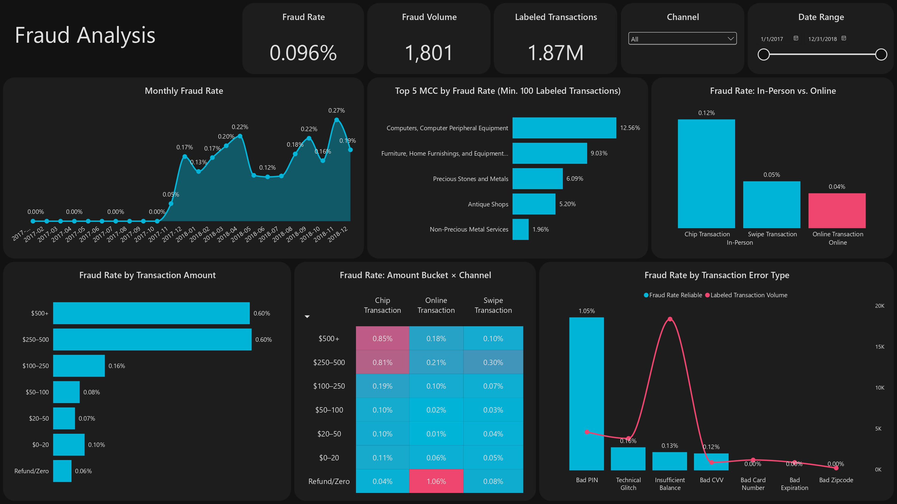
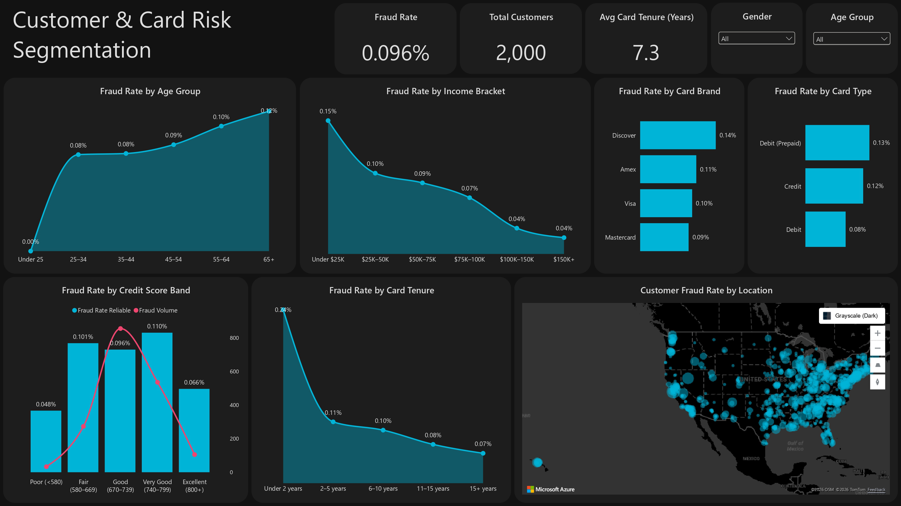

# 📊 Card Transaction Fraud, Risk Concentration & Channel Exposure Analysis: SQL & Power BI Project



## Table of Contents
1. [Project Overview & Business Case](#1-project-overview--business-case)
2. [Tools & Technologies](#2-tools--technologies)
3. [Analytics Pipeline](#3-analytics-pipeline)
4. [Business Questions, Findings & Insights](#4-business-questions-findings--insights)
5. [Key Takeaways](#5-key-takeaways)
6. [Repository Structure & How to Use](#6-repository-structure--how-to-use)

## 1. Project Overview & Business Case

### Business Case
A card-issuing bank needs to monitor transaction activity and fraud exposure across its customer and card portfolio to protect against fraud losses and support risk decisions.

### Business Problem
Fraud is rare (0.096% of labeled transactions, 2017–2018) but costly, and risk is unevenly distributed across channels, merchant categories, and customer segments. Without a consolidated view, the Fraud/Risk team can't quickly identify where fraud concentrates, which channels or merchant types carry elevated risk, or which customer segments are more exposed — slowing detection and prevention efforts.

### Audience
**Fraud/Risk Management team** — needs to monitor fraud concentration, assess channel and merchant risk, and understand which customer/card segments carry the most exposure, in order to prioritize monitoring rules and risk controls.

## 2. Tools & Technologies

- **PostgreSQL** — database design, bulk data loading, constraint management, and SQL-based data validation
- **pgAdmin 4** — database administration and query execution
- **Python (Pandas)** — initial data inspection (nulls, duplicates, types, cardinality) and JSON-to-CSV conversion
- **Power Query (M)** — data cleaning, type conversion, and column derivation
- **Power BI** — data modeling (star schema), DAX measures, and dashboard visualization
- **DAX** — custom measures for fraud rate, reliability thresholds, and relationship-aware calculations (`USERELATIONSHIP`)

## 3. Analytics Pipeline

<details>
<summary>👉 Click here to see the Data Model</summary>

<br>



</details>

<br>

**1. Data Inspection (Python):**
Loaded all 5 raw files with Pandas to check shape, nulls, duplicates, data types, and cardinality before any cleaning. Converted `mcc_codes.json` and `train_fraud_labels.json` into flat CSVs for database loading.

**2. Database Design & Load (PostgreSQL):**
Created a raw-matching schema in `sentinel_fraud_risk` (no cleaning at this layer — types mirror the source CSVs). Loaded ~22M rows via `COPY`, then added primary keys, foreign keys, and indexes after the bulk load for performance. Verified referential integrity and row counts against the Python inspection.

**3. Scoping (SQL Views):**
Created two views — `vw_transactions_scoped` and `vw_fraud_labels_scoped` — limiting the dataset to a 2-year window (2017–2018) for faster Power BI performance, while keeping the full historical data intact in the base tables.

**4. Data Cleaning (Power Query):**
Connected Power BI to the scoped views and reference tables. Cleaned currency strings, parsed dates, converted Yes/No fields to booleans, split `merchant_state` into domestic/international categories, and built a custom date table.

**5. Data Modeling (Power BI):**
Built a star schema with `transactions` as the fact table, connected to `users`, `cards`, `mcc_codes`, `date_table`, and `fraud_labels`. Resolved relationship ambiguity between `users` and `cards` paths by keeping one active and using `USERELATIONSHIP()` in DAX where the card-level path was needed.

**6. Measures & Analysis (DAX):**
Built reusable measures for volume, value, and fraud rate — including a reliability threshold (`Fraud Rate Reliable`) to exclude low-sample categories from misleading comparisons. Created bucketing columns (amount, age, income, credit score, card tenure) to support segmentation analysis.

**7. Dashboard Build (Power BI):**
Designed 3 report pages, each answering 5 business questions with charts, KPIs and slicers on Pages 2 and 3.

## 4. Business Questions, Findings & Insights

### Page 1 — Transaction & Spend Overview



<details>
<summary>👉 Click here to see the Findings and Insights</summary>

<br>

**1. What's total transaction volume and value, and how has it trended over time?**
- **Finding**: 2.79M transactions, $119.26M net value (2017–2018). Monthly volume is flat and stable, with a consistent seasonal dip every February (fewer calendar days).
- **Insight**: No growth or decline trend — activity is steady month over month, so any future spike or drop would stand out clearly against this stable baseline.

**2. Which transaction channel (swipe/chip/online) dominates activity?**
- **Finding**: Chip dominates with 1.88M transactions and $91.98M in value — far ahead of Swipe (0.44M) and Online (0.34M).
- **Insight**: Chip is the primary channel by a wide margin; risk and operational focus should weight toward in-person chip activity first.

**3. Which merchant categories (MCC) drive the most transaction volume?**
- **Finding**: Grocery Stores (334K), Miscellaneous Food Stores (246K), and Service Stations (237K) lead.
- **Insight**: Everyday, high-frequency, low-value categories dominate volume — not luxury or high-ticket purchases.

**4. How is transaction activity distributed across states?**
- **Finding**: Activity concentrates in populous states (visible cluster in the map), and 86.61% of transactions are Domestic, with international activity minimal (0.67%).
- **Insight**: This is overwhelmingly a domestic-transaction dataset; international activity is too small to be a major volume driver, but worth monitoring separately as a distinct risk category.

**5. What's the average transaction value, and how does it differ by channel?**
- **Finding**: Overall average is $50.17. Online has the highest average at $57.49, while Swipe ($49.35) and Chip ($49.04) are nearly identical.
- **Insight**: Online transactions tend to be higher-value individually, even though they're the lowest-volume channel — worth watching alongside fraud patterns on Page 2.

</details>

### Page 2 — Fraud Analysis



<details>
<summary>👉 Click here to see the Findings and Insights</summary>

<br>

**1. What's the overall fraud rate, and how does it trend over time?**
- **Finding**: Overall fraud rate is 0.096% (1,801 cases across 1.87M labeled transactions). No fraud is labeled before Nov 2017; the rate then rises from 0.05% to a peak of 0.27% in Nov 2018.
- **Insight**: The pre-Nov 2017 zero-rate likely reflects when fraud labeling/detection began in the source data, not an actual fraud-free period — fraud trend analysis should be read from Nov 2017 onward.

**2. Which MCC categories have the highest fraud rate (not just fraud count)?**
- **Finding**: Computers/Peripheral Equipment leads at 12.56%, followed by Furniture (9.03%), Precious Stones and Metals (6.09%), and Antique Shops (5.20%) — all well above the 0.096% baseline.
- **Insight**: Fraud concentrates in high-value, easily resellable goods categories, not the high-volume everyday categories identified on Page 1.

**3. Is online more fraud-prone than in-person (chip/swipe)?**
- **Finding**: No — Online has the lowest fraud rate (0.04%), while Chip is highest (0.12%), followed by Swipe (0.05%).
- **Insight**: The common assumption that online is riskier doesn't hold here; in-person chip transactions carry the greatest fraud exposure.

**4. What's the fraud rate by transaction amount bucket?**
- **Finding**: Fraud rate climbs sharply with transaction size — from ~0.06-0.10% in buckets under $100 up to 0.60% for $250+ transactions.
- **Insight**: Transaction amount is a strong, consistent fraud predictor on its own, independent of category or channel.

**5. Which transaction errors correlate most with fraud?**
- **Finding**: Bad PIN stands out sharply at 1.05% fraud rate — more than 6x the next-highest error type (Technical Glitch, 0.16%). Bad Card Number, Bad Expiration, and Bad Zipcode show no observed fraud.
- **Insight**: A Bad PIN error is one of the strongest individual fraud indicators found across the whole analysis, well above amount or category effects alone.

**Bonus — Amount × Channel interaction**: The single highest-risk cell is Refund/Zero-amount Online transactions (1.06%), higher than any dollar-value bucket on Chip. This doesn't fit the "bigger amount = bigger risk" pattern and may indicate card-testing behavior (small/zero-value transactions used to verify a stolen card before a larger purchase).

</details>

### Page 3 — Customer & Card Risk Segmentation



<details>
<summary>👉 Click here to see the Findings and Insights</summary>

<br>

**1. Which customer segments (age/income bracket) show higher fraud exposure?**
- **Finding**: Fraud rate rises steadily with age, from 0.00% (Under 25) to 0.12% (65+). It falls just as steadily with income, from 0.15% (Under $25K) to 0.04% ($150K+).
- **Insight**: Age and income point in opposite directions — older, lower-income customers show the highest fraud exposure. These effects should be considered separately, not combined into a single "high-risk profile."

**2. Which card brand/type has the highest fraud rate?**
- **Finding**: Discover has the highest brand fraud rate (0.14%), Mastercard the lowest (0.09%). By type, Debit (Prepaid) is highest (0.13%), ahead of Credit (0.12%) and Debit (0.08%).
- **Insight**: Prepaid debit carrying a higher rate than standard credit is counter-intuitive, since prepaid cards are often assumed lower-risk with no credit line attached.

**3. Is there a relationship between credit score and fraud exposure?**
- **Finding**: Fraud rate is non-linear — lowest at the extremes (Poor: 0.048%, Excellent: 0.066%) and highest in the middle bands (Good: 0.110%, Fair: 0.101%).
- **Insight**: Credit score alone doesn't cleanly predict fraud risk; mid-range scores carry more exposure than either very low or very high scores.

**4. Does card tenure (account age) relate to fraud risk?**
- **Finding**: Fraud rate declines sharply and consistently with tenure — from 0.24% (Under 2 years) to 0.07% (15+ years).
- **Insight**: Card tenure is a clean, strong, linear risk signal — newer cards carry more than 3x the fraud rate of long-held cards.

**5. Which states/cities have the highest concentration of high-risk customers?**
- **Finding**: Customer locations cluster heavily in the eastern and southern U.S., visible on the map; individual high-fraud-rate points appear scattered rather than forming one dominant region.
- **Insight**: Fraud risk by customer location doesn't show a single geographic hot zone — exposure is more tied to individual customer attributes (age, income, tenure) than to where they live. *Note: customer coordinates are rounded to ~1km precision in the source data, so map points may represent multiple customers at the same location.*

</details>

## 5. Key Takeaways

- **Fraud is rare but highly concentrated.** At 0.096% of labeled transactions overall, fraud is not evenly spread — it clusters sharply in specific merchant categories (Computers, Furniture, Precious Stones), transaction sizes ($250+), and one error type (Bad PIN).
- **Transaction amount and error type are the strongest individual fraud predictors** — both showed clear, consistent patterns independent of channel or category.
- **Common assumptions don't hold**: Online is *not* the riskiest channel (Chip is), and prepaid debit cards carry a higher fraud rate than standard credit.
- **Card tenure is the cleanest risk signal on the customer side** — fraud rate drops consistently the longer a card has been open, while credit score shows no simple linear relationship.
- **Customer risk factors point in different directions** — age and income move opposite ways, meaning no single "high-risk profile" fits both.
- **Data limitations were identified and documented rather than hidden** — including a fraud-labeling gap before Nov 2017, mixed domestic/international location data, and reduced coordinate precision for customer geography.

## 6. Repository Structure & How to Use

<details>
<summary>👉 Click here to see Repository Structure</summary>

<br>

```text
Card_Transaction_Fraud_Risk_Concentration_And_Channel_Exposure_Analysis/
│
├── Assets/                                    # README images and GIF
│
├── Dataset/Raw/                               # Source CSVs (see note below)
│
├── PowerBI/
│    ├── project_fraud.pbix                    # Full report (data model, DAX, dashboards)
│    └── sentinel_fraud_risk_dark_theme.json   # Custom report theme
│
├── Python/
│    ├── 01_json_conversion.ipynb              # JSON → CSV conversion (MCC codes, fraud labels)
│    └── 02_inspection.ipynb                   # Initial data inspection (nulls, types, duplicates)
│
├── SQL/
│    ├── 01_database.sql                       # Schema creation (raw-matching types, no constraints)
│    ├── 02_load_data.sql                      # Bulk COPY load from CSVs
│    ├── 03_constraints.sql                    # PKs, FKs, and indexes (added post-load)
│    ├── 04_sanity_check.sql                   # Row count and integrity validation
│    ├── 05_views.sql                          # Scoped views (2017–2018) for Power BI
│    └── 06_eda.sql                            # Exploratory queries behind key findings
│
└── README.md
```

</details>

<details>
<summary>👉 Click here to see How to Use</summary>

<br>

1. **Python notebooks**: run `01_json_conversion.ipynb` first — it converts `mcc_codes.json` and `train_fraud_labels.json` into the CSVs that the SQL load step requires. `02_inspection.ipynb` is optional; it documents the initial data inspection but produces no files needed downstream.
2. **Database**: connect to your PostgreSQL instance (e.g. the default `postgres` database), then run the `CREATE DATABASE sentinel_fraud_risk` statement from `01_database.sql`. Reconnect your SQL client to the new `sentinel_fraud_risk` database, then run the rest of `01_database.sql` (schema creation) followed by `02` → `05` in order (`06` is optional exploratory queries).
3. **Power BI**: open `PowerBI/project_fraud.pbix`, update the PostgreSQL connection details (Home → Transform Data → Data Source Settings) to point to your local database, then refresh.

**Note on raw data**: the source files (~1.4GB) are not included in this repository due to size. Download the original dataset from [Kaggle](https://www.kaggle.com/datasets/computingvictor/transactions-fraud-datasets) and place all files in `Dataset/Raw/` before running the Python notebooks or SQL scripts.

</details>